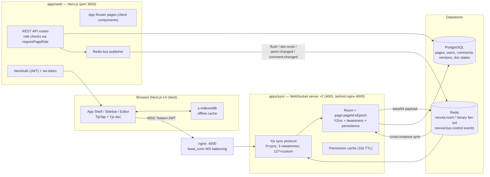

# Architecture

## System overview



## Key design decisions

### Documents are rooms keyed by `(pageId, epoch)`

`PageDocument.epoch` starts at 1 and increments whenever the document is
replaced wholesale (version restore). The room name `page:{id}:e{epoch}` is
also the IndexedDB database name, so a restore starts every client in a clean
namespace instead of merging stale offline edits into the restored state.
The sync server rejects connections whose epoch doesn't match the DB (HTTP 409
on upgrade) — the web client responds by refetching the page.

### Writes are gated before CRDT apply

Role enforcement cannot inspect an update *after* merging it (CRDTs are not
invertible). `handleMessageInner` reads the Yjs sync sub-type manually and
drops step2/update messages from `COMMENT`/`VIEW` connections **before**
`Y.applyUpdate`. Read-only clients still receive full server state.

### Cross-instance state flows through Redis

Every applied local update is published to `nexvia:room:{room}` (1-byte kind
prefix + payload, **base64-encoded** — ioredis delivers pub/sub as UTF-8
strings which corrupt binary). Other instances apply it to their in-memory
doc, which then fans out to their own connections and schedules the debounced
Postgres save (1.2s).

A control bus (`nexvia:bus`, JSON) carries: `flush`/`flush-ack` (force-save
before snapshots), `doc:reset` (epoch bump → kick clients with close 4410),
`perm:changed` (re-evaluate a connection's role live), `page:changed`,
`comment:changed`, `version:changed`.

### Snapshots and restore

- Auto snapshots: every 250 updates or 10 minutes, deduped by SHA-256,
  bounded to the 50 newest AUTO versions.
- Manual saves: explicit, labeled, bounded to 100, identical content returns
  the existing version instead of duplicating.
- Restore: creates a `RESTORE`-type snapshot of the current state first (so
  the restore itself is undoable), swaps the state, increments the epoch,
  publishes `doc:reset`. Saves are guarded `WHERE pageId AND epoch` so a
  stale room can never overwrite the restored state.

### Permission model

```
OWNER > EDIT > COMMENT > VIEW
```

- **API**: `requirePageRole(pageId, minRole)` resolves workspace membership →
  page role → active share-link role (first match wins).
- **Sync**: JWT (`?token=`, HS256, issuer `nexvia-web`) carries either user
  identity or share-link scope; permission lookups are cached 10s per
  `(userId, pageId)` and invalidated via the `perm:changed` bus event, which
  also live-pushes new roles to open sockets (close 4403 if revoked).

### Client connection lifecycle

`createCollab()` (apps/web/src/lib/collab.ts) wires Y.Doc + WebsocketProvider
+ y-indexeddb. Status mapping: `connecting → syncing → connected`, with
`offline` from either the websocket dropping or browser `online/offline`
events. Auth failures (401/4401/4403) trigger a fresh ws-token + reconnect;
close 4410 (doc reset) triggers a page refetch so the editor remounts with
the new epoch.
