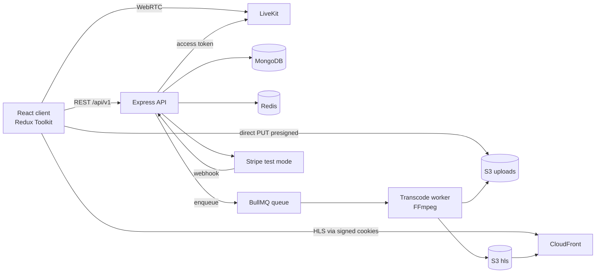

# ARCHITECTURE.md

## 1. Roles and permissions

| Capability | Student | Instructor | Admin |
|---|---|---|---|
| Browse published courses | yes | yes | yes |
| Enroll (pay) and watch lessons | yes | own courses (preview) | yes |
| Create/edit/delete own courses, sections, lessons, quizzes | no | yes | yes (any) |
| Upload video | no | yes | yes |
| Schedule and host live classes | no | yes (own courses) | yes |
| Join live classes | enrolled only | host | yes |
| Take quizzes, earn certificates | yes | no | no |
| See own earnings dashboard | no | yes | yes (all) |
| Approve/unpublish courses, manage users, run payouts | no | no | yes |

Course status flow: `draft -> pending_review -> published -> unpublished`. Admin approves `pending_review`.

## 2. System overview



## 3. Data model (MongoDB / Mongoose)

All documents have `createdAt`, `updatedAt`.

- **User**: `name, email (unique), passwordHash, role ('student'|'instructor'|'admin'), avatarUrl?, isActive`
- **Course**: `instructorId, title, slug (unique), description, category, level, priceCents, currency, thumbnailUrl?, status, tags[], totalLessons, totalDurationSec, ratingAvg?`
- **Section**: `courseId, title, order`
- **Lesson**: `courseId, sectionId, title, order, type ('video'|'quiz'|'text'), videoAssetId?, quizId?, textContent?, isFreePreview, durationSec`
- **VideoAsset**: `ownerId, courseId, originalKey (s3), status ('uploaded'|'queued'|'processing'|'ready'|'failed'), hlsPrefix? (s3 key prefix), renditions[] ({name, width, height, bitrateKbps}), durationSec?, error?, jobId?, progressPct`
- **Enrollment**: `userId, courseId, orderId, enrolledAt, completedAt?, progressPct` — unique `(userId, courseId)`
- **LessonProgress**: `userId, courseId, lessonId, completed, lastPositionSec, completedAt?` — unique `(userId, lessonId)`
- **Quiz**: `courseId, title, passMarkPct, maxAttempts?, timeLimitSec?, questions[]`
  - question: `{id, type ('single'|'multi'|'truefalse'), text, options[{id,text}], correctOptionIds[], points, explanation?}`
- **QuizAttempt**: `userId, quizId, answers[{questionId, selectedOptionIds[]}], scorePct, pointsEarned, pointsTotal, passed, startedAt, submittedAt`
- **LiveClass**: `courseId, instructorId, title, description?, scheduledAt, durationMin, roomName (unique), status ('scheduled'|'live'|'ended'|'cancelled'), startedAt?, endedAt?`
- **ChatMessage**: `liveClassId, userId, userName, text, sentAt` (persisted copy of the LiveKit chat)
- **Certificate**: `userId, courseId, certificateId (public, unique, e.g. 'LMS-2026-XXXXXX'), issuedAt, pdfKey (s3)`
- **Order**: `userId, courseId, amountCents, currency, status ('pending'|'paid'|'failed'|'refunded'), stripeSessionId, stripePaymentIntentId?`
- **EarningsLedger**: `instructorId, courseId, orderId, grossCents, platformFeeCents, netCents, status ('pending'|'available'|'paid_out'), payoutId?` — unique `orderId`
- **Payout**: `instructorId, amountCents, status ('requested'|'paid'), requestedAt, paidAt?`

Indexes: `Course(slug)`, `Course(status, category)`, `Lesson(courseId, order)`, `Enrollment(userId, courseId)` unique,
`LessonProgress(userId, lessonId)` unique, `EarningsLedger(instructorId, status)`.

## 4. Key flows

### 4.1 Video upload and transcode
1. Instructor calls `POST /videos/upload-url` -> API creates `VideoAsset(status=uploaded)` and returns S3 presigned PUT URL.
2. Browser uploads directly to S3 (`uploads/{assetId}/original.mp4`), then calls `POST /videos/:id/complete`.
3. API sets `queued` and adds a BullMQ job `transcode` (attempts 3, exponential backoff).
4. Worker downloads original, runs FFmpeg to produce HLS ladder (360p, 720p; optionally 1080p) with `.m3u8` + 6s `.ts` segments + master playlist, uploads to `hls/{assetId}/`, updates `progressPct` from FFmpeg progress, sets `ready`, stores `durationSec`.
5. On failure after retries: `failed` with `error`.
6. Client polls `GET /videos/:id` (or SSE) until `ready`.

### 4.2 Streaming through CloudFront
- S3 `hls/` bucket is private; CloudFront uses Origin Access Control.
- `GET /lessons/:id/playback` checks enrollment (or free preview / instructor / admin) and returns the master playlist URL plus **CloudFront signed cookies** (`CloudFront-Policy`, `-Signature`, `-Key-Pair-Id`) scoped to `/hls/{assetId}/*`, valid ~2h.
- Client plays with `hls.js`; sends `withCredentials`. Progress is saved every 10s via `PUT /lessons/:id/progress`.
- Dev fallback: if `CLOUDFRONT_*` env vars are absent, serve HLS from local disk through Express so work is not blocked.

### 4.3 Quizzes
- `GET /quizzes/:id` returns questions WITHOUT `correctOptionIds`.
- `POST /quizzes/:id/attempts` grades on the server: per question full credit only if selected set equals correct set; `scorePct = pointsEarned / pointsTotal * 100`; `passed = scorePct >= passMarkPct`.
- Quiz lesson counts as complete when passed. Response includes per-question correctness and explanations.

### 4.4 Progress and completion
`progressPct = completedLessons / totalLessons * 100`. When it hits 100 and all quizzes are passed, set `Enrollment.completedAt` and trigger certificate generation (idempotent).

### 4.5 Live classes
- Instructor creates `LiveClass` (scheduled). `POST /live-classes/:id/token` returns a LiveKit access token (JWT, signed server-side with `LIVEKIT_API_SECRET`): host gets `roomAdmin + canPublish`, enrolled students get `canSubscribe + canPublishData` (chat), optional hand-raise by granting `canPublish` later.
- Chat uses LiveKit data channel; client also `POST`s each message to the API (or the host client batches) so history persists and can be loaded with `GET /live-classes/:id/messages`.
- Status transitions: `scheduled -> live` (host starts) `-> ended`. Use LiveKit webhooks if time allows; otherwise host buttons.
- Use LiveKit Cloud free tier or `livekit-server --dev` in docker for local work.

### 4.6 Certificates
- On completion, `certificate.service` renders a PDF with `pdfkit` (student name, course title, instructor, date, `certificateId`, QR to `{CLIENT_URL}/verify/{certificateId}`), uploads to S3 `certificates/`, stores `Certificate`.
- `GET /certificates/:id/download` returns a short-lived signed URL; `GET /certificates/verify/:certificateId` is public.

### 4.7 Payments and earnings (Stripe test mode)
- `POST /payments/checkout` creates `Order(pending)` and a Stripe Checkout Session; client redirects.
- `POST /payments/webhook` (raw body, signature verified) on `checkout.session.completed`: mark order `paid`, create `Enrollment`, insert `EarningsLedger` with `platformFeeCents = round(gross * PLATFORM_FEE_PCT/100)` (default 20%) and `netCents = gross - fee`. Webhook handler must be idempotent (unique `orderId`).
- Free courses (`priceCents = 0`) enroll immediately without Stripe.
- Ledger entries become `available` after a hold period (config, default 0 days in demo).
- Instructor dashboard: totals (gross, fees, net, available, paid out), earnings per course, last 12 months chart, recent sales, request payout. Admin marks payout paid.

## 5. Auth
- Access JWT (15 min) in memory on the client + refresh token (7 days) in httpOnly cookie; `POST /auth/refresh`.
- Passwords hashed with `bcrypt`. `requireAuth`, `requireRole(...)`, `requireEnrollment(courseId)` middleware.
- Basic rate limiting on auth routes; `helmet`, CORS restricted to `CLIENT_URL`.

## 6. Environment variables (`.env.example`)
```
NODE_ENV, PORT, CLIENT_URL
MONGO_URI, REDIS_URL
JWT_ACCESS_SECRET, JWT_REFRESH_SECRET
AWS_REGION, S3_UPLOAD_BUCKET, S3_HLS_BUCKET, S3_CERT_BUCKET
CLOUDFRONT_DOMAIN, CLOUDFRONT_KEY_PAIR_ID, CLOUDFRONT_PRIVATE_KEY
LIVEKIT_URL, LIVEKIT_API_KEY, LIVEKIT_API_SECRET
STRIPE_SECRET_KEY, STRIPE_WEBHOOK_SECRET
PLATFORM_FEE_PCT=20
FFMPEG_PATH (optional)
```

## 7. Testing and metrics to collect (for the deliverables)
- Unit: grading, progress, earnings split, enrollment guard.
- API integration (supertest + mongodb-memory-server): auth, course CRUD, enroll, quiz attempt, webhook idempotency.
- Perf numbers to record in `/docs/RESULTS.md`: transcode time per minute of source video per rendition, API p95 latency on key endpoints (autocannon), time-to-first-frame of HLS playback, concurrent live participants tested.
