# Architecture Diagram

```mermaid
graph TB
    subgraph Client["Frontend (React + Vite + TypeScript)"]
        direction TB
        Pages[Pages / Routes]
        Components[Shared Components]
        Features[Feature Modules]
        
        Features --> Courses[Courses API]
        Features --> Video[Video API]
        Features --> Quiz[Quiz API]
        Features --> LiveClass[Live Class API]
        Features --> Certificates[Certificates API]
        Features --> Payments[Payments API]
        Features --> Enrollment[Enrollment API]
        Features --> Progress[Progress API]
        Features --> Auth[Auth Slice + RTK Query]
        
        Courses --> RTKQuery[RTK Query Base API]
        Video --> RTKQuery
        Quiz --> RTKQuery
        LiveClass --> RTKQuery
        Certificates --> RTKQuery
        Payments --> RTKQuery
        Enrollment --> RTKQuery
        Progress --> RTKQuery
        Auth --> RTKQuery
    end

    subgraph Server["Backend (Node.js + Express + TypeScript)"]
        direction TB
        Routes[API Routes /api/v1]
        Controllers[Controllers]
        Services[Services]
        Models[Mongoose Models]
        Middleware[Middleware]
        Workers[Background Workers]
        
        Routes --> AuthRoutes[Auth Routes]
        Routes --> CourseRoutes[Course Routes]
        Routes --> VideoRoutes[Video Routes]
        Routes --> EnrollmentRoutes[Enrollment Routes]
        Routes --> QuizRoutes[Quiz Routes]
        Routes --> LiveClassRoutes[Live Class Routes]
        Routes --> CertificateRoutes[Certificate Routes]
        Routes --> PaymentRoutes[Payment Routes]
        Routes --> UserRoutes[User Routes]
        Routes --> PlaybackRoutes[Playback Routes]
        
        Controllers --> AuthCtrl[Auth Controller]
        Controllers --> CourseCtrl[Course Controller]
        Controllers --> VideoCtrl[Video Controller]
        Controllers --> EnrollmentCtrl[Enrollment Controller]
        Controllers --> QuizCtrl[Quiz Controller]
        Controllers --> LiveClassCtrl[Live Class Controller]
        Controllers --> CertificateCtrl[Certificate Controller]
        Controllers --> PaymentCtrl[Payment Controller]
        
        Services --> AuthSvc[Auth Service]
        Services --> CourseSvc[Course Service]
        Services --> VideoSvc[Video/S3/Storage Service]
        Services --> PlaybackSvc[Playback Service]
        Services --> CloudFrontSvc[CloudFront Service]
        Services --> ProgressSvc[Progress Service]
        Services --> QuizSvc[Quiz Service]
        Services --> CertificateSvc[Certificate Service]
        Services --> PaymentSvc[Payment Service]
        Services --> LiveClassSvc[Live Class Service]
        
        Models --> UserModel[User]
        Models --> CourseModel[Course]
        Models --> SectionModel[Section]
        Models --> LessonModel[Lesson]
        Models --> VideoAssetModel[VideoAsset]
        Models --> EnrollmentModel[Enrollment]
        Models --> LessonProgressModel[LessonProgress]
        Models --> QuizModel[Quiz]
        Models --> QuizAttemptModel[QuizAttempt]
        Models --> LiveClassModel[LiveClass]
        Models --> ChatMessageModel[ChatMessage]
        Models --> OrderModel[Order]
        Models --> EarningsLedgerModel[EarningsLedger]
        Models --> PayoutModel[Payout]
        Models --> CertificateModel[Certificate]
        
        Middleware --> AuthMW[Auth Middleware]
        Middleware --> RoleMW[Role Middleware]
        Middleware --> ValidateMW[Validation Middleware]
        Middleware --> RateLimitMW[Rate Limit Middleware]
        Middleware --> WebhookMW[Webhook Middleware]
        
        Workers --> TranscodeWorker[Transcode Worker]
        Workers --> FFmpeg[FFmpeg Module]
    end

    subgraph Infrastructure["Infrastructure & External Services"]
        direction TB
        MongoDB[(MongoDB)]
        Redis[(Redis)]
        BullMQ[BullMQ Queue]
        S3[S3 / Local Storage]
        CloudFront[CloudFront CDN]
        LiveKit[LiveKit Server]
        Stripe[Stripe Payments]
        FFmpegBinary[FFmpeg Binary]
    end

    Client -->|HTTP/REST + WebSocket| Server
    Server -->|Mongoose| MongoDB
    Server -->|ioredis| Redis
    Server -->|BullMQ| BullMQ
    Server -->|AWS SDK / Local| S3
    Server -->|CloudFront SDK| CloudFront
    Server -->|LiveKit SDK| LiveKit
    Server -->|Stripe SDK| Stripe
    Workers -->|spawn| FFmpegBinary
    Workers -->|Queue| BullMQ
    BullMQ -->|Redis| Redis

    style Client fill:#e3f2fd,stroke:#1976d2,stroke-width:2px
    style Server fill:#fff3e0,stroke:#f57c00,stroke-width:2px
    style Infrastructure fill:#e8f5e9,stroke:#388e3c,stroke-width:2px
```

## Component Overview

### Frontend (React + Vite + TypeScript)
- **RTK Query** for server state management and caching
- **Redux Toolkit** for client state (auth)
- **React Router v7** for routing with protected routes
- **Feature-based architecture** with co-located API, types, and components
- **Tailwind CSS** for styling
- **Chart.js + react-chartjs-2** for earnings charts
- **hls.js** for HLS video playback
- **livekit-client** for live class WebRTC

### Backend (Node.js + Express + TypeScript)
- **Express 5** with strict TypeScript
- **Mongoose** ODM for MongoDB
- **Zod** for request validation
- **JWT** authentication with refresh token rotation
- **BullMQ** for background job processing
- **FFmpeg** for video transcoding to HLS
- **pdfkit** for PDF certificate generation

### Data Models
- **User** - roles: student, instructor, admin
- **Course** - sections, lessons, status flow (draft → pending_review → published)
- **Section/Lesson** - ordered curriculum, types: video, quiz, text
- **VideoAsset** - upload tracking, HLS transcoding status
- **Enrollment/LessonProgress** - student progress tracking
- **Quiz/QuizAttempt** - auto-graded assessments
- **LiveClass/ChatMessage** - scheduled live sessions
- **Order/EarningsLedger/Payout** - payment and revenue tracking
- **Certificate** - PDF certificates with verification

### External Integrations
- **S3-compatible storage** (AWS S3 or local disk fallback)
- **CloudFront** signed cookies for secure HLS delivery (with local fallback)
- **LiveKit** for WebRTC live classes (dev mode in docker-compose)
- **Stripe** test mode for payments (with local demo fallback)